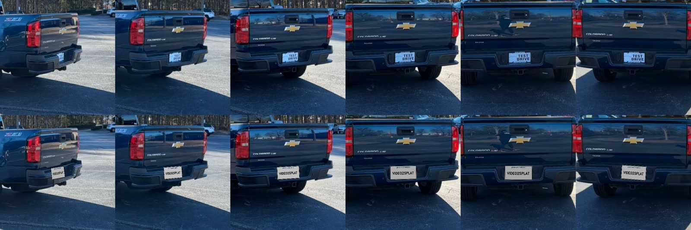

# video-to-splat

One command from a phone walk-around video to a photorealistic 3D model you can open in a browser.

```
phone video ──► frame selection ──► camera poses ──► beta splatting ──► web viewer
               sharpness + motion    COLMAP or VGGT    (6 GB GPU)        beta-splatting-showcase
```

<!-- TODO: demo GIF + live link once the first capture is trained -->

## Quick start

```bash
python run.py my_car.mp4                                   # frames -> COLMAP -> train
python run.py my_car.mp4 --poses vggt                      # poses from one VGGT forward pass
python run.py my_car.mp4 --showcase ../beta-splatting-showcase --title "My Car"   # publish to the gallery
```

Each stage writes to `runs/<name>/` and is skipped on re-runs (`--redo train` to force one).
`runs/<name>/report.json` collects timings and quality numbers for every stage.

## Stages

### 1. Frame selection ([`v2s/frames.py`](v2s/frames.py))

Sampling a hand-held video at a fixed rate gives blurry frames and uneven coverage, because people slow
down at corners. Instead, every frame is scored for:

- **sharpness**: variance of the Laplacian on a 320 px proxy;
- **exposure**: fraction of clipped pixels;
- **camera motion**: median Farneback optical-flow magnitude from the previous frame.

The timeline is split into windows of **equal accumulated motion** (equal viewpoint change, not equal time)
and the sharpest well-exposed frame of each window is kept. On a synthetic test with a pause, a 6× speed
change and every third frame blurred, it picks no blurred frames, nothing from the pause, and frames in
exact proportion to the motion. `frame_selection.png` shows the scores and the picks.

### 2. Camera poses

| Backend | How | Speed | Notes |
|---|---|---|---|
| `colmap` ([`v2s/colmap.py`](v2s/colmap.py)) | SIFT, exhaustive matching (closes the 360° loop), incremental SfM, undistortion | minutes | most accurate, uses every frame |
| `vggt` ([`v2s/vggt_poses.py`](v2s/vggt_poses.py)) | one forward pass of [VGGT](https://github.com/facebookresearch/vggt) (CVPR 2025) over an evenly spaced subset | seconds | bf16 weights + chunked depth head fit 28 frames in 6 GB; cameras mapped from VGGT's 518 px padded square back to original pixels; point cloud lifted from confidence-filtered depth |

Both write the same undistorted COLMAP layout (`images/`, `sparse/0/`). VGGT output goes through a small
COLMAP binary writer ([`v2s/colmap_io.py`](v2s/colmap_io.py)) that COLMAP's own `model_analyzer` reads back,
so there's no `pycolmap` version conflict with the trainer.

### Plate replacement ([`replace_plates.py`](replace_plates.py), [`v2s/plates.py`](v2s/plates.py))

Blurring plates frame by frame flickers, misses plates at grazing angles, and still bakes a smeared
plate into the 3D model. Instead, each plate is located **once, in 3D**, and re-projected into every view:

1. detect plates per frame (optional YOLOv8 plate model; any detector that returns boxes works);
2. group detections by physical plate, using the SfM points that fall inside each box;
3. triangulate the corners (DLT, outlier views dropped), then refine a 3D rectangle with robust least
   squares so its projection matches every detection box. The plate is constrained to be level, since
   boxes barely constrain in-plane rotation;
4. project the rectangle into **every** frame that faces it (≤ 55° off-axis), skipping views where SfM
   points show something solid in front of it;
5. warp in a replacement plate with a homography, matched to the original's brightness and edge-feathered.



On the Chevy capture the detector fired in 19 of 180 frames, and the 3D plate was placed in 40, so the
21 extra views the detector missed are covered too. The splat is trained on the edited images, so the new
plate is consistent from every angle. Run it between poses and training:

```bash
python run.py car.mp4 --until poses
python replace_plates.py runs/car/dataset --text "MY CAR" --sheet plates.jpg
python run.py car.mp4 --redo train
```

### 3. Training ([`v2s/train.py`](v2s/train.py))

[Deformable Beta Splatting](https://github.com/RongLiu-Leo/beta-splatting) (Liu et al., SIGGRAPH 2025)
replaces Gaussian kernels with Beta kernels and view-dependent color with spherical Beta lobes, so it
needs fewer primitives for the same quality. Defaults (`--cap-max 300000`, 1600 px frames) fit a 6 GB laptop GPU.

### 4. Export ([`v2s/export.py`](v2s/export.py))

Prunes near-transparent splats and computes the orbit lock, camera ring and cinematic tour from the
training cameras, using the tools in
[beta-splatting-showcase](https://github.com/neelgajera/beta-splatting-showcase). The scene then appears in the gallery.

## Results

Chevy Colorado, 70 s iPhone walk-around (1920×1080 HEVC), on a laptop RTX 3060 (6 GB):

| Stage | Result |
|---|---|
| Frame selection | 180 of 2,098 frames kept |
| Poses, COLMAP | 180/180 registered in one model, 74.9k points, 0.50 px mean reprojection error, 11.8 min |
| Poses, VGGT | 28 frames in 34 s (5.4 GB peak); cameras within **0.48°** (rotation) and **0.67%** of orbit radius (position) of COLMAP's |
| Plate replacement | 1 plate, detected in 19 frames, replaced in 40 |
| Training | 30k iterations, 300k primitives, ~38 min |
| Export | 261k splats after pruning (31 MB PLY), orbit lock and tour computed from the training cameras |

The same poses also drive [spin-stabilizer](https://github.com/neelgajera/spin-stabilizer), which turns the walk-around into a level
turntable spin (jitter 40 → 10 px).

## Setup (Windows, CUDA)

```bash
git clone --recursive https://github.com/neelgajera/video-to-splat
conda create -n splat python=3.10 -y && conda activate splat
conda install -c nvidia/label/cuda-11.8.0 cuda-toolkit -y      # nvcc inside the env, matches torch below
pip install torch==2.1.2 torchvision==0.16.2 --index-url https://download.pytorch.org/whl/cu118
# from a "x64 Native Tools" prompt (Visual Studio C++ build tools):
set CUDA_HOME=%CONDA_PREFIX%\Library && set TORCH_CUDA_ARCH_LIST=8.6 && set PIP_NO_BUILD_ISOLATION=0
cd third_party/beta-splatting/submodules && pip install --no-build-isolation . && cd .. && pip install --no-build-isolation .
```

COLMAP must be on `PATH`, or set `V2S_COLMAP` to `COLMAP.bat`.

## Credits and licenses

- This repository: MIT.
- [beta-splatting](https://github.com/RongLiu-Leo/beta-splatting) (Apache-2.0) and
  [VGGT](https://github.com/facebookresearch/vggt) (VGGT License) are git submodules under `third_party/`.
  The default `facebook/VGGT-1B` checkpoint is for research only; set `V2S_VGGT_WEIGHTS` to the
  `VGGT-1B-Commercial` checkpoint for commercial use.
- [COLMAP](https://colmap.github.io) (BSD).
- Plate detection (optional): [Ultralytics](https://github.com/ultralytics/ultralytics) (AGPL-3.0) with the
  [Koushim/yolov8-license-plate-detection](https://huggingface.co/Koushim/yolov8-license-plate-detection)
  weights, saved as `weights/plate-yolov8.pt`. It's only imported by `replace_plates.py`. Any detector
  that returns boxes can replace it in `v2s/plates.detect`.

## Background

I built the production version of this pipeline (video to 3D cars for dealerships) at Spyne. This is an
independent re-implementation written from scratch on public tools and my own captures. It contains no
Spyne code, models or data.
